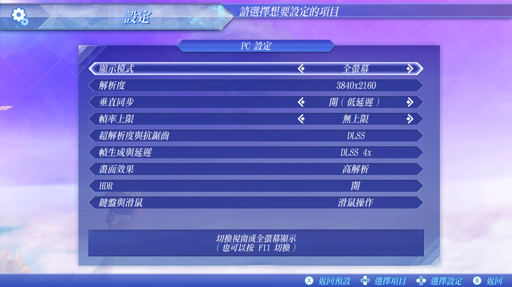
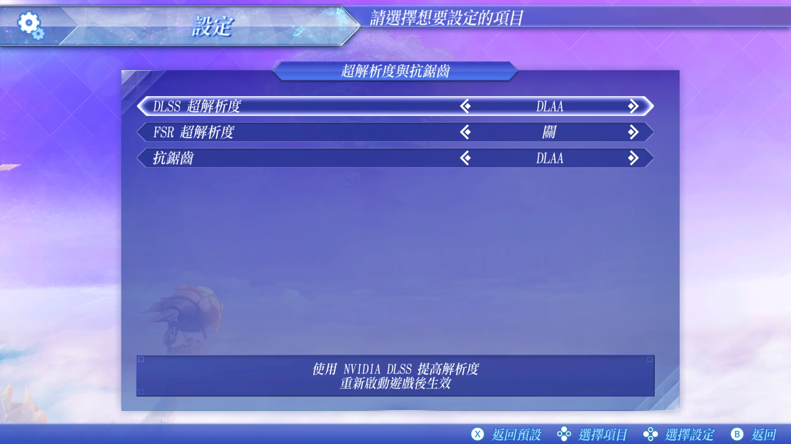
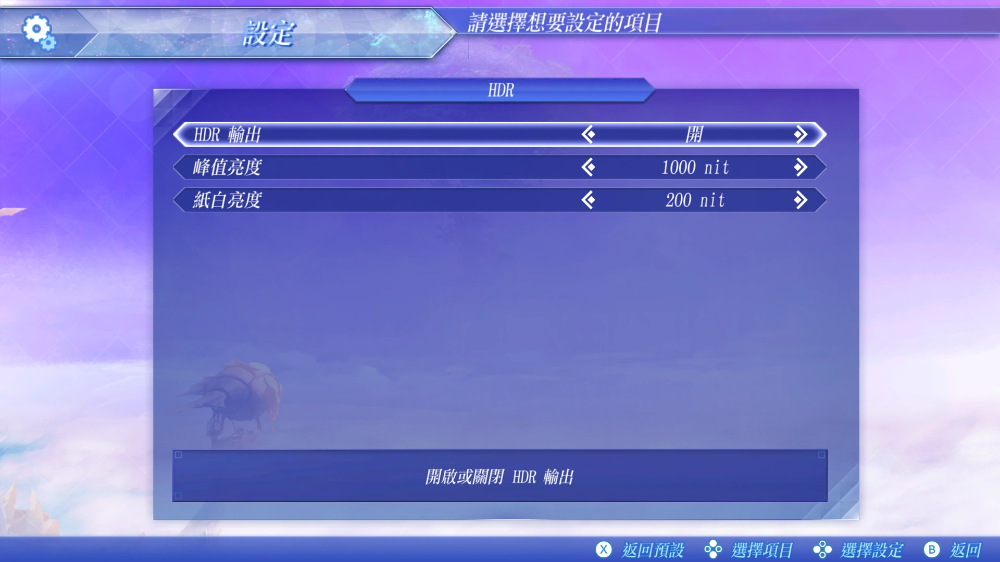

# XC2-Recomp

**Xenoblade Chronicles 2 — Native PC Recompilation**

[English](#english) · [简体中文](#简体中文) · [Roadmap / 路线图](ROADMAP.md)

> [!NOTE]
> This repository contains documentation only. It provides no builds, no downloads and no game files.
> 本仓库只有说明文件，不提供任何构建产物、下载或游戏文件。

  
  
  
  

<em>Settings screen ・ 设定画面</em>

---

## English

### Overview

XC2-Recomp is a native Windows port of *Xenoblade Chronicles 2* for Nintendo Switch, made by static
recompilation. The game's AArch64 machine code is translated ahead of time and built as an x86-64 Windows program,
and the system, graphics and audio services the game calls are reimplemented natively. It is not an emulator, and
not a Yuzu / Ryujinx bundle.

- **Target version:** the Japanese release for the original Nintendo Switch (Program ID `0100F3400332C000`),
  update 3.0.0. This release includes Japanese, Traditional Chinese and Simplified Chinese text.
- **You need your own game:** playing requires a copy of the game that you own and have legally dumped yourself.
- **No game content here:** this project does not include or distribute any game content, keys or decryption
  tools, and it does not explain how to dump or decrypt a game.

### Acknowledgements & Project Direction

First and foremost, I would like to express my sincere appreciation to **TheMonadoGuy, the creator of the Monado project**.

Monado's achievements in bringing Nintendo Switch games natively to PC have been a genuine source of inspiration for me.

I understand that TheMonadoGuy is also working on a PC version of Xenoblade Chronicles 2.

I would like to make one thing clear: **XC2-Recomp was not created with the intention of directly competing with Monado or its author.**

This project follows its own development direction, with a particular focus on the needs of Chinese-speaking players, including Chinese-language compatibility, regional game-version support, usability, and PC-oriented enhancements.

I am also looking forward to seeing TheMonadoGuy's upcoming XC2 project.

If the opportunity arises, I would be very happy to exchange ideas or collaborate. Should the author choose to make the relevant work available under suitable terms, I would also welcome the opportunity to contribute to or build upon it, with the author's permission and in accordance with its licensing conditions.

Whether our projects remain independent or eventually find opportunities to collaborate, I hope they can contribute to each other's progress and ultimately provide a better Xenoblade Chronicles 2 experience for players.

My sincere thanks again to TheMonadoGuy for the inspiration and contributions.

#### Technical Acknowledgements

XC2-Recomp uses or has learned from the following open-source projects. Each keeps its own license.

| Project | License | Role |
|---|---|---|
| [SuperMarioWonderRecomp](https://github.com/BluetufieBugado/SuperMarioWonderRecomp) (Wonder runtime) by BelmanteGu | MIT | Base of the recompiler and runtime |
| Ryujinx shader translator (`Ryujinx.Graphics.Shader`), Ryujinx Team and Contributors | MIT | Shader translation |
| [AC-Recomp](https://github.com/swaymun/AC-Recomp) | MIT | Runtime components |
| [LASRecomp](https://github.com/peiikai/LASRecomp) and [letsgo-recomp](https://github.com/raulzrrs/letsgo-recomp) | MIT | Runtime components |
| AMD FidelityFX Super Resolution (FSR) | FSR 1: MIT; FidelityFX SDK: AMD's FidelityFX SDK license | Upscaling and frame generation |
| SMAA (Jorge Jimenez et al.) | MIT | Anti-aliasing |
| NVIDIA Streamline SDK | MIT (the DLSS components are NVIDIA's own and are not included) | NVIDIA DLSS and Reflex integration |
| FFmpeg | LGPL-2.1-or-later | Video decoding; linked dynamically and not included |
| [seedds/nxnative](https://github.com/seedds/nxnative) | MIT | Approaches studied for reference; concepts only, no code copied |
| [Savage Wind Recomp](https://github.com/Revivedx/SavageWindRecomp) | MIT | Approaches studied for reference; concepts only, no code copied |
| xc3_lib, xenomods | MIT | File format and game structure reference; no code copied |

No GPL-licensed code is included; GPL projects were consulted for behaviour only. No leaked or confidential SDK
material is used.

### Goals

Everything below is a goal. The [roadmap](ROADMAP.md) groups the same goals by stage and adds long-term ideas.

**Graphics**

- PC graphics settings in a tab of the game's own Options screen, with no separate launcher or settings window
- Internal render resolution set separately from output resolution; resolution that can follow the window size;
  display mode options
- The game's dynamic resolution as an on/off option
- Sharp UI and text at high output resolutions such as 4K
- Upscaling with NVIDIA DLSS Super Resolution or AMD FSR Super Resolution
- Anti-aliasing without an upscaler: the game's original TAA, SMAA, or off
- Frame generation with NVIDIA DLSS Multi Frame Generation or AMD FSR Frame Generation, applied to the whole game
  or to cutscenes only
- HDR output
- Texture quality setting, with support for high-resolution texture replacement
- Separate switches to turn off depth of field and motion blur

**Performance**

- 60 fps and higher, with game logic that behaves the same as at the original 30 fps
- Frame rate caps: 30, 60, 120, 144, 165 or unlimited
- V-sync options
- NVIDIA Reflex for lower latency
- Shader pipeline precompilation, to reduce stutter the first time you enter a new area
- Automatic tuning of caches and thread counts to your RAM, GPU and CPU cores

**Controls**

- Keyboard and mouse: mouse camera control, number keys for Arts, and fully rebindable keys

**Mods**

- RomFS mods in the folder layout used by Ryujinx and yuzu, loaded on top of the game (LayeredFS) without
  changing the original files

**Saves**

- Save protection: an automatic backup each time you play, and recovery from damaged saves

**Stability**

- Rendering and behaviour that match the original game, without errors introduced by the port
- Logs, and a crash report saved automatically if the game crashes

### Long-term ideas

After the release, the [roadmap](ROADMAP.md) lists ideas with no timeline: quality-of-life mods, optional gameplay
mods, system mods, ray-traced shadows (research) and original features inspired by content added in the Nintendo
Switch 2 Edition. Every mod that changes gameplay or balance will be optional; by default the game plays as the
original.

### Distribution

- This repository does not and will not provide game executables, ExeFS / RomFS, keys, firmware, DLC, game assets,
  decryption tools or download links. Requests for any of these will be closed.
- Any source code or tools published later will first be reviewed for licensing, provenance and redistribution
  rights.

### Disclaimer

XC2-Recomp is an independent, non-commercial fan project. It is not affiliated with, endorsed by or sponsored by
Nintendo, Monolith Soft or any other company named here, and it is not an official PC version of the game. Nintendo
and Monolith Soft retain all rights to the game and its assets. *Xenoblade Chronicles* and *Nintendo Switch* are
trademarks of Nintendo. NVIDIA, DLSS and Reflex are trademarks of NVIDIA; AMD and FSR are trademarks of AMD. All
other trademarks belong to their respective owners.

### License

No license has been chosen yet.

---

## 简体中文

### 项目简介

XC2-Recomp 是 Nintendo Switch 版《异度神剑 2》的 Windows 原生移植，采用静态重编译：游戏的 AArch64 机器码
预先转译，构建为 x86-64 的 Windows 程序；游戏调用的系统、图形与音频服务则以原生方式重新实现。本项目不是
模拟器，也不是 Yuzu／Ryujinx 整合包。

- **目标版本**：初代 Nintendo Switch 的日版（Program ID `0100F3400332C000`），3.0.0 更新。此版本内含日文、
  繁体中文与简体中文。
- **需要你自己的游戏**：游玩时需要你自己拥有、并由你自行合法提取（dump）的游戏。
- **这里没有任何游戏内容**：本项目不包含、也不分发任何游戏内容、密钥或解密工具，也不说明如何提取或解密游戏。

### 致谢与项目定位

首先，我想特别感谢 **Monado 项目及其作者 TheMonadoGuy**。

Monado 在 Nintendo Switch 游戏原生 PC 移植方面所取得的成果，给了我很大的启发，也让我更加期待《异度神剑》系列能够在 PC 平台上获得更完整的游戏体验。

我了解到，TheMonadoGuy 目前也正在开发《异度神剑 2》（Xenoblade Chronicles 2）的 PC 版本。

我希望特别说明：**XC2-Recomp 并不是为了与 Monado 作者直接竞争而建立的项目。**

这个项目有自己的开发方向，尤其希望提前考虑中文玩家的实际需求，包括中文语言支持、游戏版本兼容性、操作体验，以及符合 PC 玩家习惯的画面设置与功能扩展。

我同样期待 TheMonadoGuy 未来公开的 XC2 项目。

如果条件允许，我非常愿意与作者交流、合作；如果未来作者愿意开放相关成果，并且许可条件允许，我也希望有机会在其工作基础上继续研究和改进，而不是重复投入已经解决的问题。

无论两个项目最终以独立还是合作的方式发展，我都希望它们能够互相促进，让更多玩家享受到更好的《异度神剑 2》PC 游戏体验。

再次感谢 TheMonadoGuy 的贡献与启发。

#### 技术致谢

XC2-Recomp 使用或参考了以下开源项目，它们各自保留自己的授权。

| 项目 | 授权 | 用途 |
|---|---|---|
| [SuperMarioWonderRecomp](https://github.com/BluetufieBugado/SuperMarioWonderRecomp)（Wonder runtime），作者 BelmanteGu | MIT | 重编译器与 runtime 的基础 |
| Ryujinx 的 shader 翻译器（`Ryujinx.Graphics.Shader`），Ryujinx Team and Contributors | MIT | shader 翻译 |
| [AC-Recomp](https://github.com/swaymun/AC-Recomp) | MIT | runtime 组件 |
| [LASRecomp](https://github.com/peiikai/LASRecomp) 与 [letsgo-recomp](https://github.com/raulzrrs/letsgo-recomp) | MIT | runtime 组件 |
| AMD FidelityFX Super Resolution（FSR） | FSR 1：MIT；FidelityFX SDK：AMD 的 FidelityFX SDK 授权 | 超分辨率与帧生成 |
| SMAA（Jorge Jimenez 等） | MIT | 抗锯齿 |
| NVIDIA Streamline SDK | MIT（DLSS 组件属于 NVIDIA，不包含在内） | NVIDIA DLSS 与 Reflex 接入 |
| FFmpeg | LGPL-2.1-or-later | 视频解码；动态链接，不包含在内 |
| [seedds/nxnative](https://github.com/seedds/nxnative) | MIT | 参考其做法；仅参考概念，未复制代码 |
| [Savage Wind Recomp](https://github.com/Revivedx/SavageWindRecomp) | MIT | 参考其做法；仅参考概念，未复制代码 |
| xc3_lib、xenomods | MIT | 文件格式与游戏结构参考；未复制代码 |

未包含任何 GPL 授权的代码；GPL 项目只用于了解行为。未使用任何泄露或保密的 SDK 资料。

### 目标

以下全部是目标。[路线图](ROADMAP.md)按阶段列出同样的目标，并加上长期构想。

**画面**

- PC 画面设置放在游戏自带「选项」画面里的一个分页，不另开启动器或设置窗口
- 内部渲染分辨率与输出分辨率分开设置；分辨率可以随窗口大小调整；显示模式选项
- 游戏的动态分辨率可以开关
- 在 4K 等高输出分辨率下，界面与文字依然清晰
- 以 NVIDIA DLSS 超分辨率或 AMD FSR 超分辨率提升分辨率
- 不使用超分辨率时的抗锯齿：游戏原本的 TAA、SMAA 或关闭
- 以 NVIDIA DLSS 多帧生成或 AMD FSR 帧生成补帧，可以应用到整个游戏，或只在过场动画中
- HDR 输出
- 材质质量设置，支持高分辨率贴图替换
- 景深与动态模糊可以分别关闭

**性能**

- 60 fps 以上，游戏逻辑与原本的 30 fps 一致
- 锁帧档位：30、60、120、144、165、不限
- 垂直同步选项
- NVIDIA Reflex，降低延迟
- 预先编译 shader pipeline，减少第一次进入新区域时的卡顿
- 根据内存、GPU 与 CPU 核心数自动调整缓存与线程数

**操作**

- 键盘鼠标：鼠标控制镜头、数字键释放战技、所有按键都可以自由改键

**Mod**

- 支持 Ryujinx 与 yuzu 文件夹格式的 RomFS mod，以 LayeredFS 方式叠加加载，不修改原始文件

**存档**

- 存档保护：每次游玩自动备份，存档损坏时可以恢复

**稳定性**

- 画面与行为和原版一致，没有移植造成的错误
- 日志；游戏崩溃时自动保存崩溃报告

### 长期构想

发布版之后，[路线图](ROADMAP.md)列出没有时间表的构想：减少繁琐操作的优化 Mod、可选的玩法 Mod、系统 Mod、
光线追踪阴影（研究方向），以及参考 Nintendo Switch 2 Edition 新增内容的原创实现。所有会改变玩法或平衡的 Mod
都是可选的，默认保持原版体验。

### 发布说明

- 本仓库现在不会、将来也不会提供游戏可执行文件、ExeFS／RomFS、密钥、固件、DLC、游戏资源、解密工具或下载链接。
  索取以上内容的 Issue 会直接关闭。
- 将来公开的任何源代码或工具，都会先经过授权、来源与可再分发性的审查。

### 免责声明

XC2-Recomp 是独立、非商业的爱好者项目，与任天堂（Nintendo）、Monolith Soft 及本文提到的任何其他公司都没有
关系，未获得其认可或赞助，也不是本游戏的官方 PC 版。任天堂与 Monolith Soft 保有本游戏及其素材的一切权利。
*Xenoblade Chronicles*（异度神剑）与 *Nintendo Switch* 是任天堂的商标；NVIDIA、DLSS 与 Reflex 是 NVIDIA 的
商标；AMD 与 FSR 是 AMD 的商标。其他商标均属于各自的权利人。

### 授权

目前尚未选定授权。
