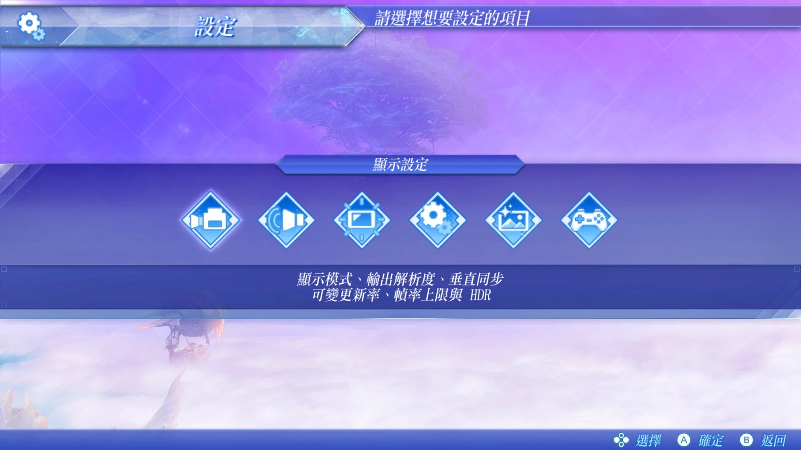
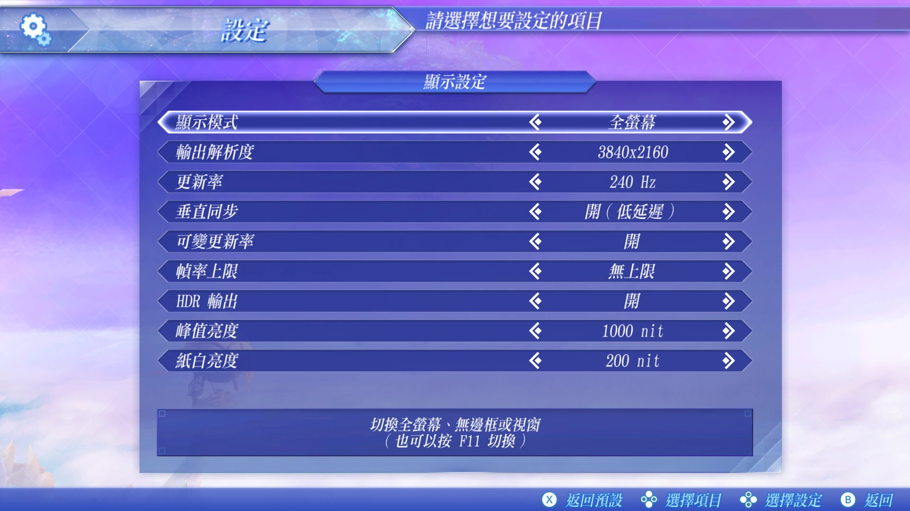
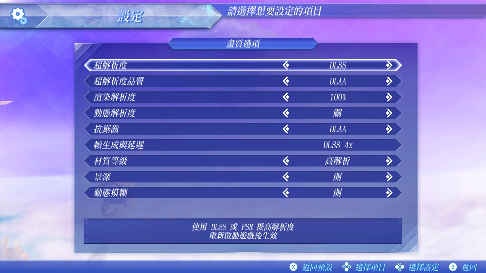
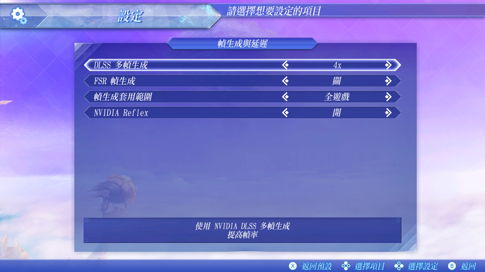

# XC2-Recomp

**Xenoblade Chronicles 2 — Native PC Recompilation**

[English](#english) · [简体中文](#简体中文) · [Roadmap / 路线图](ROADMAP.md)

> [!NOTE]
> This repository contains documentation only. It provides no builds, no downloads and no game files.
> 本仓库只有说明文件，不提供任何构建产物、下载或游戏文件。
>
> **Early demo: nearly done.** It is only a showcase: there is no download, and it is not a playable release. Its outline
> was set early in the project, so many of the features listed here are not in it.
>
> **初期演示：接近完成。** 这只是展示用，不提供下载，也不是可游玩的发布。它的框架在立项初期就定下了，所以这里列出的许多功能并没有放进去。

> [!IMPORTANT]
> **Experimental: toward the Nintendo Switch 2 Edition**
>
> We have started an experiment to bring what the Nintendo Switch 2 Edition improves, starting with higher-quality assets and possibly its new content later, into this PC version. It builds on the original Switch version; it is not a separate port of the Switch 2 Edition.
>
> It is research for now, and how far it can go is not known yet. If it works out, it may become the final goal of "Xenoblade Chronicles 2: REFORGED Edition".
>
> There is no promise of a source release, and this repository does not explain how to use it to play the game. The techniques behind it will be shared later in lawful ways, such as the implementation guides listed below. This repository will not provide any Switch 2 Edition files, assets, keys or extraction tools, and will not show its screenshots or official promotional art.
>
> **实验中：向 Nintendo Switch 2 Edition 看齐**
>
> 我们开始了一项实验：把 Nintendo Switch 2 Edition 带来的改进吸收进这个 PC 版本，先从更高画质的素材开始，之后可能包括它新增的内容。做法是在原本 Switch 版的基础上升级，而不是另做一个 Switch 2 Edition 的移植。
>
> 目前还在研究阶段，能做到哪一步还不知道。如果可行，它可能成为《异度神剑 2：REFORGED Edition》的最终目标。
>
> 不承诺开源，本仓库也不会说明如何用它来游玩。相关技术之后会以合法的方式公开，例如下方列出的实现指南。本仓库不会提供任何 Switch 2 Edition 的文件、素材、密钥或提取工具，也不会放它的截图或官方宣传图。

## 关于这个项目

这个项目是一项研究：让这款游戏在 PC 上尽可能完美——在画面、流畅度和操作上做出一套完整、接近重制的 PC 原生体验，从设定画面到键鼠操作，都像一款真正的 PC 游戏。它不以发布可游玩的版本为目标，也不说明如何用它来游玩。研究得到的技术会写成实现指南公开；想在可游玩的 PC 移植版中使用这些功能，欢迎依照指南自行合并。

《异度神剑 2：REFORGED Edition》（非官方粉丝作品，与任天堂及 Monolith Soft 无关）是这项研究想达到的最终形态，也是我给自己游玩的版本取的名字；它不会发布。对应的 logo 之后会制作，希望以后的整合者可以拿去用。

我不公开源码，因为这首先是做给我自己玩的：当年我没能把这款游戏玩完，这次想用自己最满意的方式重新走一遍。公开这些进展，是希望看到这份工作的人知道它的出发点。

## About this project

This project is research into making this game as good as it can be on PC: a complete, near-remake native PC experience in visuals, smoothness and controls, that feels like a true PC game from the settings menu to mouse-and-keyboard support. It does not aim to release a playable version and does not explain how to play the game with it. Its techniques are published as implementation guides; anyone who wants these features in a playable PC port is welcome to merge them by following the guides.

"Xenoblade Chronicles 2: REFORGED Edition" (an unofficial fan work, not affiliated with Nintendo or Monolith Soft) is the final form this research aims for, and also my name for the version I play myself; it will not be released. A logo for it will be made, and I hope future integrators will use it.

The source code is not public because this is, first of all, something I'm making for myself: I never finished the game back then, and this time I want to play it through the way I've always wanted. I share the progress so that anyone who sees this work knows where it comes from.

## 回馈社区

这个项目从许多开源项目和开发者公开的研究中受益良多。主线源码不会公开，但我认为帮助别人是必须做的事：凡是这个项目原创、能帮到别人的技术成果——特别是这款游戏原生 PC 化中还没有公开解法的问题——都会整理成实现指南，或作为独立的工具与代码公开，让其他开发者可以直接参考和使用。

下面列出这个项目的特色功能和目前状态。每一项完成后，我都会发布对应的实现指南。

| # | 名称 | 说明 | 状态 | 指⁠南 |
|---|---|---|---|---|
| 1 | 可变刷新率 | 无边框和独占全屏都支持 G-SYNC 与 FreeSync | 指南已发布 | [指⁠南](https://github.com/circerio/XC2-Recomp-Contributions/tree/main/guides/vrr) |
| 2 | 锁帧时刷新率稳定 | 锁帧时显示器的刷新率大多保持稳定 | 指南已发布 | [指⁠南](https://github.com/circerio/XC2-Recomp-Contributions/tree/main/guides/vrr#5-the-refresh-meter-jumps-at-a-locked-frame-rate) |
| 3 | HDR 输出 | HDR10 与 scRGB 输出，可调峰值亮度和纸白，并保留高光 | 指南已发布 | [指⁠南](https://github.com/circerio/XC2-Recomp-Contributions/tree/main/guides/hdr) |
| 4 | 独占全屏 | 与无边框并存的真正独占模式，支持 Alt+Tab 和 F11 | 指南已发布 | [指⁠南](https://github.com/circerio/XC2-Recomp-Contributions/tree/main/guides/vrr) |
| 5 | 任意帧率下的自动曝光 | 无论帧率多少，自动曝光的适应时间都与 30 fps 相同 | 指南已发布 | [指⁠南](https://github.com/circerio/XC2-Recomp-Contributions/tree/main/guides/exposure) |
| 6 | 与帧率无关的游戏逻辑 | 计时器、菜单连发和等待在任何帧率下速度都相同 | 开发中 |  |
| 7 | 原版设定画面内的 PC 设定 | PC 选项就在游戏原本的设定画面里，没有启动器，也没有独立窗口 | 指南已发布 | [指⁠南](https://github.com/circerio/XC2-Recomp-Contributions/tree/main/guides/settings) |
| 8 | 内部与输出分辨率 | 场景使用独立的分辨率，界面和文字保持输出分辨率的清晰度 | 指南已发布 | [指⁠南](https://github.com/circerio/XC2-Recomp-Contributions/tree/main/guides/resolution) |
| 9 | 存档保护与崩溃报告 | 写入途中崩溃也能恢复的存档、自动备份，以及易读的崩溃报告 | 指南已发布 | [指⁠南](https://github.com/circerio/XC2-Recomp-Contributions/tree/main/guides/saves) |
| 10 | 鼠标操作菜单 | 在游戏原本的菜单里指向、点击和滚动 | 接近完成 |  |
| 11 | 按情境变化的键鼠操作 | 按键在不同情境下符合 PC 玩家的习惯，并显示键盘提示 | 接近完成 |  |
| 12 | 帧生成与 Reflex | NVIDIA DLSS 多帧生成、AMD FSR 帧生成与 NVIDIA Reflex | 接近完成（DLSS 2 倍已实机确认；3 倍以上与 FSR 帧生成尚未） |  |

## Giving back

This project has benefited greatly from open-source projects and the research other developers have shared publicly. The main source code will stay closed, but helping others is something I consider essential: original work from this project that can help other people — especially problems in bringing this game natively to PC that have no public solution yet — will be written up as implementation guides, or released as standalone tools and code, so other developers can use it directly.

Below are the project's signature features and their current status. When each one is finished, I will publish an implementation guide for it.

| # | Name | Description | Status | Guide |
|---|---|---|---|---|
| 1 | Variable refresh rate | G-SYNC and FreeSync in borderless and exclusive fullscreen | Guide published | [Guide](https://github.com/circerio/XC2-Recomp-Contributions/tree/main/guides/vrr) |
| 2 | Steady refresh at a locked frame rate | A monitor's refresh rate mostly holds steady at a locked frame rate | Guide published | [Guide](https://github.com/circerio/XC2-Recomp-Contributions/tree/main/guides/vrr#5-the-refresh-meter-jumps-at-a-locked-frame-rate) |
| 3 | HDR output | HDR10 and scRGB output with peak brightness and paper white, and highlights kept | Guide published | [Guide](https://github.com/circerio/XC2-Recomp-Contributions/tree/main/guides/hdr) |
| 4 | Exclusive fullscreen | A true exclusive mode next to borderless, with Alt+Tab and F11 handled | Guide published | [Guide](https://github.com/circerio/XC2-Recomp-Contributions/tree/main/guides/vrr) |
| 5 | Auto exposure at any frame rate | Eye adaptation takes the same time as at 30 fps, at any frame rate | Guide published | [Guide](https://github.com/circerio/XC2-Recomp-Contributions/tree/main/guides/exposure) |
| 6 | Frame-rate independent game logic | Timers, menu repeat and waits run at the same speed at any frame rate | In development |  |
| 7 | PC settings in the game's own menu | PC options inside the game's own Options screen, with no launcher and no separate window | Guide published | [Guide](https://github.com/circerio/XC2-Recomp-Contributions/tree/main/guides/settings) |
| 8 | Internal and output resolution | The scene at its own resolution, with the interface and text sharp at the output resolution | Guide published | [Guide](https://github.com/circerio/XC2-Recomp-Contributions/tree/main/guides/resolution) |
| 9 | Save protection and crash reports | Saves that survive a crash during writing, automatic backups, and a readable crash report | Guide published | [Guide](https://github.com/circerio/XC2-Recomp-Contributions/tree/main/guides/saves) |
| 10 | Mouse in menus | Pointing, clicking and scrolling in the game's own menus | Nearly done |  |
| 11 | Context-aware keyboard and mouse | Keys that mean what a PC player expects in each situation, with keyboard prompts | Nearly done |  |
| 12 | Frame generation and Reflex | NVIDIA DLSS Multi Frame Generation, AMD FSR Frame Generation and NVIDIA Reflex | Nearly done (DLSS 2x confirmed in hands-on play; 3x and higher, and FSR Frame Generation, not yet) |  |

[开发日志／Development log](DEVLOG.md)

  
  
  
  

<em>Settings screen ・ 设定画面</em>

---

## English

### Overview

XC2-Recomp is research into a native Windows port of *Xenoblade Chronicles 2* for Nintendo Switch, made by
static recompilation. It is not an emulator, and not a Yuzu / Ryujinx bundle.

- **Target version:** the Japanese release for the original Nintendo Switch (Program ID `0100F3400332C000`),
  update 3.0.0. This release includes Japanese, Traditional Chinese and Simplified Chinese text.
- **No playable version:** this project does not provide a playable version of the game, and it does not explain how
  to play the game with it.
- **No game content here:** this project does not include or distribute any game content, keys or decryption
  tools, and it does not explain how to dump or decrypt a game.

### Acknowledgements & Project Direction

First and foremost, I would like to express my sincere appreciation to **TheMonadoGuy, the creator of the Monado project**.

Monado's achievements in bringing Nintendo Switch games natively to PC have been a genuine source of inspiration for me.

I would like to make one thing clear: **XC2-Recomp does not compete with any PC version of this game or any project working toward one:** not with TheMonadoGuy and Monado, which inspired this project, and not with those that came later, such as AksharDP's xc2-recomp.

I've reached out to AksharDP about working together. There has been no reply so far, which is completely fine: the guides here are just as open to xc2-recomp, and anyone is welcome to merge them whenever they're useful.

This project follows its own research direction, with a particular focus on the Japanese 3.0.0 release and its Chinese text, and on PC-oriented enhancements.

Whatever TheMonadoGuy works on next, I wish them all the best.

If the opportunity arises, I would be very happy to exchange ideas or collaborate.

Whether projects stay independent or find chances to collaborate, I hope they can help each other move forward, and that the guides here are useful to all of them.

My sincere thanks again to TheMonadoGuy for the inspiration and contributions.

My thanks also to AksharDP for the research shared publicly in xc2-recomp, and to jmars125 for xcx-recomp, which it is built on.

#### Technical Acknowledgements

Thanks to the following open-source projects. Each keeps its own license.

| Project | License |
|---|---|
| [SuperMarioWonderRecomp](https://github.com/BluetufieBugado/SuperMarioWonderRecomp) | MIT |
| Ryujinx (`Ryujinx.Graphics.Shader`) | MIT |
| [AC-Recomp](https://github.com/swaymun/AC-Recomp) | MIT |
| [LASRecomp](https://github.com/peiikai/LASRecomp) | MIT |
| [letsgo-recomp](https://github.com/raulzrrs/letsgo-recomp) | MIT |
| AMD FidelityFX Super Resolution (FSR) | FSR 1: MIT; FidelityFX SDK: AMD's FidelityFX SDK license |
| SMAA | MIT |
| NVIDIA Streamline SDK | MIT |
| AMD Vulkan Memory Allocator (VMA) | MIT |
| FFmpeg | LGPL-2.1-or-later |
| [seedds/nxnative](https://github.com/seedds/nxnative) | MIT |
| [Savage Wind Recomp](https://github.com/Revivedx/SavageWindRecomp) | MIT |
| Monado (TheMonadoGuy) | MIT |
| [xcx-recomp](https://github.com/jmars125/xcx-recomp) (jmars125) | MIT |
| [xc2-recomp](https://github.com/AksharDP/xc2-recomp) (AksharDP) | MIT |
| xc3_lib | MIT |
| xenomods | MIT |

### Features

Features are listed in three groups: Implemented, Nearly done and Planned. The [roadmap](ROADMAP.md) lists the same
features and adds the final form this research aims for, and long-term ideas.

#### Implemented

**Graphics**

- PC graphics settings inside the game's own Options screen, with no separate launcher or settings window
- Internal render resolution set separately from output resolution; resolution that can follow the window size;
  display mode options
- Exclusive fullscreen
- The game's dynamic resolution as an on/off option
- Sharp UI and text at high output resolutions such as 4K
- Upscaling with NVIDIA DLSS Super Resolution or AMD FSR Super Resolution
- Anti-aliasing without an upscaler: the game's original TAA, SMAA, or off
- HDR output with brightness adjustment (peak brightness and paper white)
- Texture quality setting, with support for high-resolution texture replacement
- Anisotropic filtering setting
- Separate switches to turn off depth of field and motion blur

**Performance**

- 60 fps and higher (battles and events stay at 30 fps for now)
- Frame rate caps: 30, 60, 120, 144, 165 or unlimited
- V-sync options
- Variable refresh rate (G-SYNC / FreeSync)
- Background shader precompilation

**Controls**

- Keyboard and mouse: mouse camera control, number keys for Arts, and fully rebindable keys
- Automatic switching between controller and keyboard and mouse
- Button prompts for Xbox, PlayStation and Nintendo controller layouts

**Mods**

- RomFS mods in the folder layout used by Ryujinx and yuzu, loaded without changing the original files

**Saves**

- Save protection: an automatic backup each time you play, and recovery from damaged saves

**Stability**

- Logs, and a crash report saved automatically if the game crashes

#### Nearly done

**Graphics**

- Frame generation with NVIDIA DLSS Multi Frame Generation or AMD FSR Frame Generation, applied to the whole game
  or to cutscenes only (DLSS 2x confirmed in hands-on play; 3x and higher, and FSR Frame Generation, not yet)

**Performance**

- NVIDIA Reflex for lower latency

**Controls**

- Direct mouse control of menus

#### Planned

**Graphics**

- More texture quality levels (High, Max)
- Model detail (LOD) levels

**Performance**

- Less stutter on first visits to new places
- Automatic tuning to your RAM, GPU and CPU cores

#### Planned: long-term ideas

Beyond the features above, the [roadmap](ROADMAP.md) lists ideas with no timeline: quality-of-life mods, optional
gameplay mods, system mods, ray-traced shadows (research) and an experiment to bring the Nintendo Switch 2 Edition's
improvements into this version (see the top of this page). Every mod that changes gameplay or balance will be optional;
by default the game plays as the original.

### Distribution

- No playable version will be released. This repository does not and will not provide game executables,
  ExeFS / RomFS, keys, firmware, DLC, game assets, decryption tools or download links. Requests for any of these
  will be closed.
- Any source code or tools published later will first be reviewed for licensing, provenance and redistribution
  rights.

### Disclaimer

XC2-Recomp is an independent, non-commercial fan project. It is not affiliated with, endorsed by or sponsored by
Nintendo, Monolith Soft or any other company named here, and it is not an official PC version of the game. Nintendo
and Monolith Soft retain all rights to the game and its assets. *Xenoblade Chronicles*, *Nintendo Switch* and *Nintendo Switch 2* are
trademarks of Nintendo. NVIDIA, DLSS, G-SYNC and Reflex are trademarks of NVIDIA; AMD, FSR and FreeSync are
trademarks of AMD. All other trademarks belong to their respective owners.

No GPL-licensed code is included, and no leaked or confidential SDK material is used.

### License

No license has been chosen yet.

---

## 简体中文

### 项目简介

XC2-Recomp 是一项研究：以静态重编译把 Nintendo Switch 版《异度神剑 2》原生移植到 Windows。本项目不是模拟器，也不是
Yuzu／Ryujinx 整合包。

- **目标版本**：初代 Nintendo Switch 的日版（Program ID `0100F3400332C000`），3.0.0 更新。此版本内含日文、
  繁体中文与简体中文。
- **不提供可游玩的版本**：本项目不提供可游玩的版本，也不说明如何用它来游玩。
- **这里没有任何游戏内容**：本项目不包含、也不分发任何游戏内容、密钥或解密工具，也不说明如何提取或解密游戏。

### 致谢与项目定位

首先，我想特别感谢 **Monado 项目及其作者 TheMonadoGuy**。

Monado 在 Nintendo Switch 游戏原生 PC 移植方面所取得的成果，给了我很大的启发，也让我更加期待《异度神剑》系列能够在 PC 平台上获得更完整的游戏体验。

我希望特别说明：**XC2-Recomp 不与任何《异度神剑 2》PC 版本或朝这个方向努力的项目竞争**——无论是启发了这个项目的 TheMonadoGuy 与 Monado，还是之后出现的项目，例如 AksharDP 的 xc2-recomp。

我曾向 AksharDP 表达合作的意愿，目前还没有收到回复，这完全没关系：这里的指南对 xc2-recomp 同样开放，任何时候觉得有用，都欢迎合并。

这个项目有自己的研究方向，尤其着重于日版 3.0.0 及其中文文字，以及符合 PC 玩家习惯的画面设置与功能扩展。

无论 TheMonadoGuy 接下来做什么，我都衷心祝福。

如果条件允许，我非常愿意与作者交流、合作。

无论各个项目独立发展还是有机会合作，我都希望大家能够互相促进，也希望这里的指南对每个项目都有帮助。

再次感谢 TheMonadoGuy 的贡献与启发。

同时感谢 AksharDP 在 xc2-recomp 公开的研究成果，以及 jmars125 的 xcx-recomp（xc2-recomp 以它为基础）。

#### 技术致谢

感谢以下开源项目，它们各自保留自己的授权。

| 项目 | 授权 |
|---|---|
| [SuperMarioWonderRecomp](https://github.com/BluetufieBugado/SuperMarioWonderRecomp) | MIT |
| Ryujinx（`Ryujinx.Graphics.Shader`） | MIT |
| [AC-Recomp](https://github.com/swaymun/AC-Recomp) | MIT |
| [LASRecomp](https://github.com/peiikai/LASRecomp) | MIT |
| [letsgo-recomp](https://github.com/raulzrrs/letsgo-recomp) | MIT |
| AMD FidelityFX Super Resolution（FSR） | FSR 1：MIT；FidelityFX SDK：AMD 的 FidelityFX SDK 授权 |
| SMAA | MIT |
| NVIDIA Streamline SDK | MIT |
| AMD Vulkan Memory Allocator（VMA） | MIT |
| FFmpeg | LGPL-2.1-or-later |
| [seedds/nxnative](https://github.com/seedds/nxnative) | MIT |
| [Savage Wind Recomp](https://github.com/Revivedx/SavageWindRecomp) | MIT |
| Monado（TheMonadoGuy） | MIT |
| [xcx-recomp](https://github.com/jmars125/xcx-recomp)（jmars125） | MIT |
| [xc2-recomp](https://github.com/AksharDP/xc2-recomp)（AksharDP） | MIT |
| xc3_lib | MIT |
| xenomods | MIT |

### 功能

功能分为三组：已实现、接近完成与目标。[路线图](ROADMAP.md)列出同样的功能，并加上这项研究想达到的最终形态与长期构想。

#### 已实现

**画面**

- PC 画面设置放在游戏自带的「选项」画面里，不另开启动器或设置窗口
- 内部渲染分辨率与输出分辨率分开设置；分辨率可以随窗口大小调整；显示模式选项
- 独占全屏
- 游戏的动态分辨率可以开关
- 在 4K 等高输出分辨率下，界面与文字依然清晰
- 以 NVIDIA DLSS 超分辨率或 AMD FSR 超分辨率提升分辨率
- 不使用超分辨率时的抗锯齿：游戏原本的 TAA、SMAA 或关闭
- HDR 输出与亮度调整（峰值亮度、纸白）
- 材质质量设置，支持高分辨率贴图替换
- 各向异性过滤设置
- 景深与动态模糊可以分别关闭

**性能**

- 60 fps 以上（战斗和事件暂时维持 30 fps）
- 锁帧档位：30、60、120、144、165、不限
- 垂直同步选项
- 可变刷新率（G-SYNC／FreeSync）
- 后台预编译着色器

**操作**

- 键盘鼠标：鼠标控制镜头、数字键释放战技、所有按键都可以自由改键
- 在手柄与键盘鼠标之间自动切换
- 按键图标（Xbox、PlayStation、任天堂配置）

**Mod**

- 支持 Ryujinx 与 yuzu 文件夹格式的 RomFS mod，加载时不修改原始文件

**存档**

- 存档保护：每次游玩自动备份，存档损坏时可以恢复

**稳定性**

- 日志；游戏崩溃时自动保存崩溃报告

#### 接近完成

**画面**

- 以 NVIDIA DLSS 多帧生成或 AMD FSR 帧生成补帧，可以应用到整个游戏，或只在过场动画中（DLSS 2 倍已实机确认；3 倍以上与 FSR 帧生成尚未）

**性能**

- NVIDIA Reflex，降低延迟

**操作**

- 鼠标直接操作菜单

#### 目标

**画面**

- 更多材质质量档位（高、最高）
- 模型细节（LOD）档位

**性能**

- 减少首次进入新场景时的卡顿
- 根据内存、GPU 与 CPU 核心数自动调整

#### 目标：长期构想

除上述功能外，[路线图](ROADMAP.md)还列出没有时间表的构想：减少繁琐操作的优化 Mod、可选的玩法 Mod、系统 Mod、
光线追踪阴影（研究方向），以及把 Nintendo Switch 2 Edition 的改进吸收进这个版本的实验（见本页开头）。所有会改变玩法或平衡的 Mod
都是可选的，默认保持原版体验。

### 发布说明

- 不会发布可游玩的版本。本仓库现在不会、将来也不会提供游戏可执行文件、ExeFS／RomFS、密钥、固件、DLC、游戏资源、解密工具或下载链接。
  索取以上内容的 Issue 会直接关闭。
- 将来公开的任何源代码或工具，都会先经过授权、来源与可再分发性的审查。

### 免责声明

XC2-Recomp 是独立、非商业的爱好者项目，与任天堂（Nintendo）、Monolith Soft 及本文提到的任何其他公司都没有
关系，未获得其认可或赞助，也不是本游戏的官方 PC 版。任天堂与 Monolith Soft 保有本游戏及其素材的一切权利。
*Xenoblade Chronicles*（异度神剑）、*Nintendo Switch* 与 *Nintendo Switch 2* 是任天堂的商标；NVIDIA、DLSS、G-SYNC 与 Reflex 是
NVIDIA 的商标；AMD、FSR 与 FreeSync 是 AMD 的商标。其他商标均属于各自的权利人。

未包含任何 GPL 授权的代码，也未使用任何泄露或保密的 SDK 资料。

### 授权

目前尚未选定授权。
